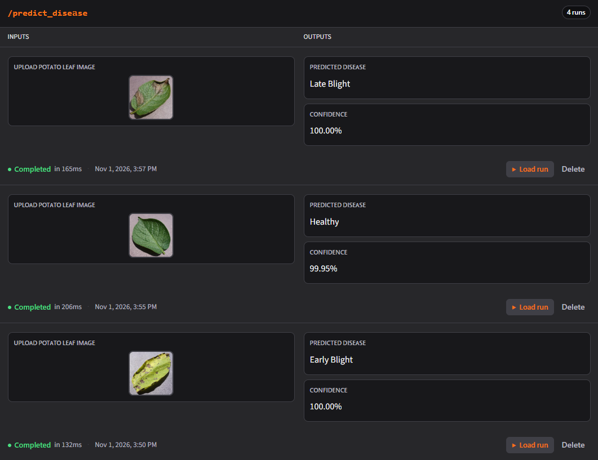

# Potato Disease Classification Using CNN

A deep learning application that identifies potato leaf diseases from images using a Convolutional Neural Network (CNN). The model classifies uploaded leaf images into three categories: Early Blight, Late Blight, and Healthy.

## Project Overview

Potato plants can be affected by different leaf diseases that impact crop health and productivity. This project uses deep learning and image classification to identify common potato leaf conditions from images.

The trained CNN model is deployed using TensorFlow Serving and Docker, with a FastAPI backend and a Gradio interface for image uploads and predictions.

## Key Features

- Classifies potato leaf images into three categories.
- Uses a CNN model built with TensorFlow and Keras.
- Provides prediction confidence scores.
- Serves the trained model through TensorFlow Serving.
- Uses FastAPI to handle prediction requests.
- Provides a simple Gradio interface for users.

## Technologies Used

| Category | Technologies |
|---|---|
| Programming Language | Python |
| Deep Learning | TensorFlow, Keras |
| Model | Convolutional Neural Network (CNN) |
| Backend | FastAPI |
| Model Serving | TensorFlow Serving |
| Deployment | Docker |
| User Interface | Gradio |
| Image Processing | NumPy, Pillow |
| Evaluation | Scikit-learn, Matplotlib |

## Dataset

The project uses the **PlantVillage potato leaf dataset**, containing 2,152 images across three classes.

| Class | Number of Images |
|---|---:|
| Early Blight | 1,000 |
| Late Blight | 1,000 |
| Healthy | 152 |
| **Total** | **2,152** |

The dataset is divided into training, validation, and testing subsets.

## Model Architecture

A Convolutional Neural Network (CNN) is used to learn visual patterns from potato leaf images.

The model includes:

- Image resizing and rescaling
- Convolutional layers with ReLU activation
- Max-pooling layers
- Flatten layer
- Fully connected dense layer
- Softmax output layer for three-class classification

**Model Details**

- Input image size: 256 × 256 pixels
- Number of classes: 3
- Trainable parameters: 183,747

## Model Performance

The trained model was evaluated using a separate test dataset.

| Evaluation Metric | Result |
|---|---:|
| Test Images | 256 |
| Test Accuracy | **97.66%** |
| Test Loss | 0.0841 |

### Confusion Matrix

The confusion matrix shows the model's classification performance across the three classes.


## Application Screenshots

### Gradio Predictions

The application allows users to upload a potato leaf image and view the predicted disease class along with its confidence score.



## Application Architecture

The application follows this prediction workflow:

1. User uploads a potato leaf image through the Gradio interface.
2. Gradio sends the image to the FastAPI backend.
3. FastAPI processes the image and sends a prediction request to TensorFlow Serving.
4. TensorFlow Serving loads the trained CNN model and generates predictions.
5. FastAPI returns the predicted class and confidence score.
6. Gradio displays the prediction to the user.

## Project Structure

```text
Potato_Disease_CNN/
│
├── screenshots/
│   └── all_predictions.png
│
├── potatoes_model/
│   └── 1/
│       ├── saved_model.pb
│       └── variables/
│
├── app.py
├── main.py
├── trained_potato_model.h5
├── potato-disease-classification-model.ipynb
├── confusion_matrix.png
└── README.md
```

## How to Run the Project

### 1. Clone the Repository

```bash
git clone https://github.com/rahulkumaryenugula0308-dev/potato-disease-classification-cnn.git
cd potato-disease-classification-cnn
```

### 2. Create and Activate a Virtual Environment

```bash
python -m venv .venv
```

Windows:

```bash
.venv\Scripts\activate
```

### 3. Install Dependencies

Install the required packages:

```bash
pip install tensorflow fastapi uvicorn numpy pillow requests python-multipart gradio
```

### 4. Start TensorFlow Serving

Make sure Docker Desktop is running. From the project directory, start the model container:

```bash
docker run -d --name potatoes_model_container -p 8501:8501 -v "${PWD}/potatoes_model:/models/potatoes_model" -e MODEL_NAME=potatoes_model tensorflow/serving
```

### 5. Start the FastAPI Backend

Open a terminal and run:

```bash
python -m uvicorn main:app --host 127.0.0.1 --port 8000
```

FastAPI documentation:

http://127.0.0.1:8000/docs

### 6. Start the Gradio Application

Open another terminal, activate the virtual environment, and run:

```bash
python app.py
```

Open the Gradio application at:

http://127.0.0.1:8502

Upload a potato leaf image to get the prediction.

## API Endpoint

| Method | Endpoint | Description |
|---|---|---|
| GET | `/ping` | Checks whether the API is running |
| POST | `/predict` | Accepts an image and returns the predicted class and confidence score |

## Author

**Rahul Kumar Yenugula**

GitHub: [rahulkumaryenugula0308-dev](https://github.com/rahulkumaryenugula0308-dev)

**Repository:** [Potato Disease Classification Using CNN](https://github.com/rahulkumaryenugula0308-dev/potato-disease-classification-cnn)